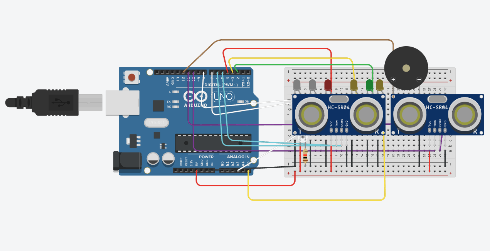

# Sistema Automotivo Inteligente com Arduino

## Integrantes
- Luis Felipe
- Lucas Rumph

## Objetivo
Simular três sistemas que existem em carros modernos usando Arduino Uno:
1. **Farol automático:** o sensor de luz detecta quando escurece e acende os LEDs brancos.
2. **Sensor de ponto cego:** quando passa um objeto ao lado, acende o LED amarelo.
3. **Sensor de ré:** LEDs indicam a distância do obstáculo e o buzzer apita quando está muito perto.

## Componentes
**Microcontrolador:** Arduino Uno

**Sensores**
- Sensor de luz (LDR)
- Sensor ultrassônico HC-SR04 (ponto cego)
- Sensor ultrassônico HC-SR04 (ré)

**Atuadores**
- 2 LEDs brancos (faróis)
- 1 LED amarelo (ponto cego)
- LEDs verde, amarelo e vermelho (sensor de ré)
- Buzzer

**Extras:** resistores, protoboard e jumpers

## Custo estimado
| Item | Valor |
|---|---|
| Arduino Uno | R$ 60 |
| 2x HC-SR04 | R$ 40 |
| LDR | R$ 3 |
| LEDs | R$ 3 |
| Buzzer | R$ 4 |
| Resistores | R$ 3 |
| Protoboard | R$ 15 |
| Jumpers | R$ 10 |
| **Total** | **R$ 138** |

## Como funciona
**Farol automático:** o Arduino lê o sensor de luz. Se o valor fica abaixo de 400, entende que está escuro e acende os dois LEDs brancos.

**Ponto cego:** o HC-SR04 mede a distância. Se tiver algo a menos de 50 cm, o LED amarelo acende.

**Sensor de ré:** o outro HC-SR04 mede a distância do obstáculo:
| Distância | Resultado |
|---|---|
| mais de 100 cm | LED verde |
| 50 a 100 cm | LED amarelo |
| 20 a 50 cm | LED vermelho + bip lento |
| menos de 20 cm | LED vermelho + bip rápido |

## Esquema de ligação
| Componente | Pino |
|---|---|
| Sensor de luz (LDR) | A3 |
| HC-SR04 ré (TRIG / ECHO) | 10 / 11 |
| HC-SR04 ponto cego (TRIG / ECHO) | 5 / 6 |
| LED branco 1 | 8 |
| LED branco 2 | 7 |
| LED ponto cego | A5 |
| LED verde | 2 |
| LED amarelo | 3 |
| LED vermelho | 4 |
| Buzzer | 12 |

## Vídeo
O vídeo de demonstração foi entregue pelo Microsoft Teams.

## Código
Arquivo: [`sistema_automotivo.ino`](sistema_automotivo/sistema_automotivo.ino)

## Como usar
1. Abrir o arquivo `sistema_automotivo.ino` na Arduino IDE
2. Fazer o upload para o Arduino Uno
3. Abrir o monitor serial (9600) para ver as leituras de luz e distância
